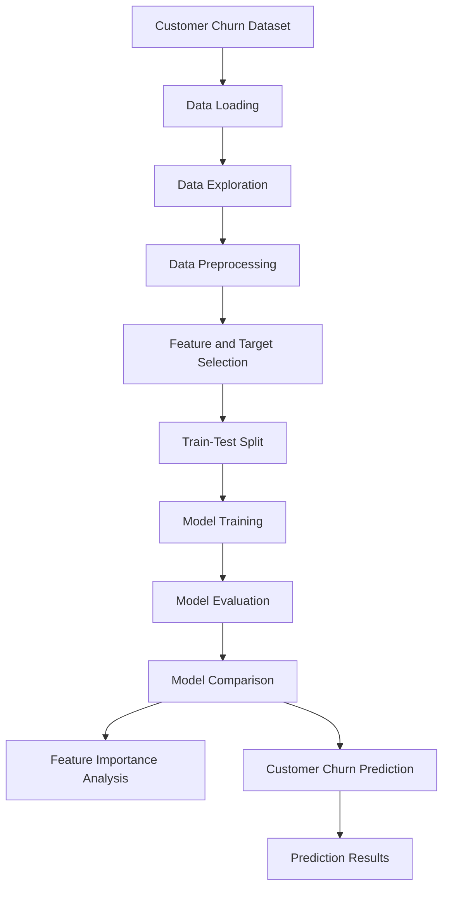
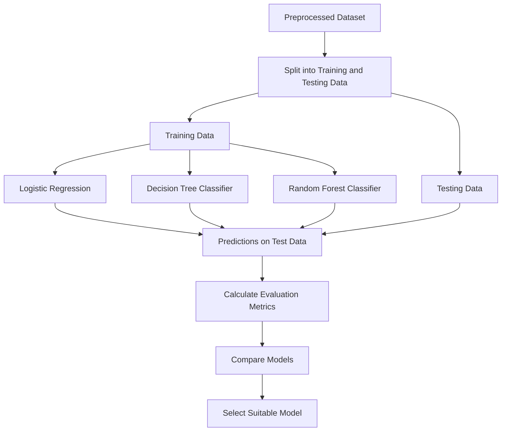
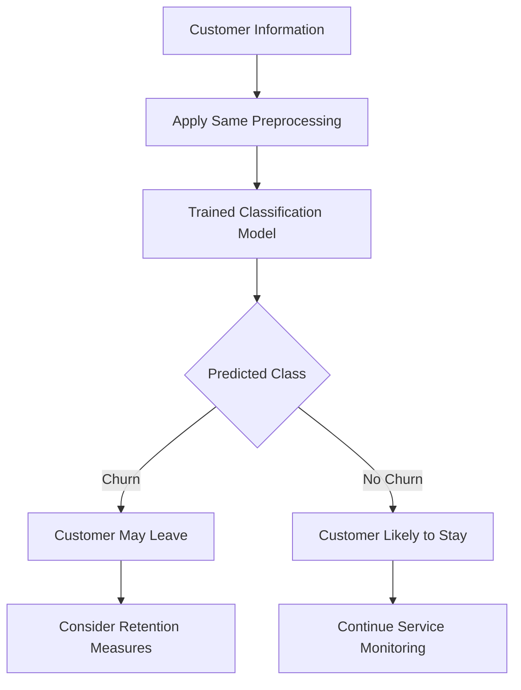

# Customer Churn Prediction

## 1. Project Overview

Customer Churn Prediction is a Machine Learning project that aims to identify customers who are likely to stop using a company's services.

By analyzing customer information, service subscriptions, account details, and usage-related attributes, the project builds classification models that can help recognize patterns associated with customer churn.

Predicting churn can help businesses understand customer behavior, identify customers who may need attention, and make better customer-retention decisions.

## 2. Problem Statement

Customer churn is a major challenge for businesses that provide subscription-based services. Losing customers can affect revenue and long-term business growth.

The objective of this project is to use historical customer data to develop Machine Learning models that classify customers as:

- **Churn:** The customer is likely to leave the service.
- **No Churn:** The customer is likely to continue using the service.

## 3. Project Objectives

- Explore and understand the customer dataset.
- Identify patterns and factors associated with customer churn.
- Prepare the data for Machine Learning.
- Train multiple classification algorithms.
- Evaluate and compare model performance.
- Identify important features influencing predictions.
- Generate churn predictions for customer records.

## 4. Dataset Description

The project uses the **Telco Customer Churn dataset**, which contains customer-related information for a telecommunications service.

Dataset source: [Telco Customer Churn – Kaggle](https://www.kaggle.com/datasets/alfathterry/telco-customer-churn-11-1-3)

The dataset includes information such as:

| Feature category | Examples |
|---|---|
| Customer details | Gender, senior citizen status, dependents |
| Account information | Tenure, contract type, payment method |
| Services | Internet service, phone service, online security |
| Charges | Monthly charges, total charges |
| Target variable | Churn |

The target variable indicates whether a customer has discontinued the service.

## 5. Technologies and Libraries

- **Python** – Programming language
- **Google Colab** – Notebook environment
- **Pandas** – Data manipulation and analysis
- **NumPy** – Numerical operations
- **Matplotlib** – Data visualization
- **Seaborn** – Statistical visualization
- **Scikit-learn** – Data preprocessing, model training, and evaluation

## 6. System Architecture

The following diagram represents the overall structure of the project.



## 7. Project Workflow

### Step 1: Data Loading
The dataset is loaded into the notebook using Pandas.

### Step 2: Data Exploration
The data is examined to understand its structure, feature types, missing values, and churn distribution.

### Step 3: Data Preprocessing
The data is prepared for model training. This may include handling missing or unsuitable values and converting categorical information into a numerical format.

### Step 4: Feature and Target Selection
Customer attributes are used as input features, while the churn column is selected as the target variable.

### Step 5: Train-Test Split
The dataset is divided into training and testing subsets. The training data is used to build the models, while the testing data is used to evaluate their performance on unseen records.

### Step 6: Model Training
Multiple classification algorithms are trained using the prepared data.

### Step 7: Model Evaluation
The trained models are evaluated using classification metrics and confusion matrices.

### Step 8: Model Comparison
The performance of the models is compared to understand which algorithm performs best for this dataset.

## 8. Machine Learning Models

The project uses the following classification algorithms:

### Logistic Regression
A classification algorithm that estimates the probability of a customer belonging to a particular class, such as churn or no churn.

### Decision Tree Classifier
A tree-based algorithm that makes predictions by applying a sequence of feature-based decision rules.

### Random Forest Classifier
An ensemble algorithm that combines predictions from multiple decision trees to produce a final classification.

## 9. Model Training and Evaluation Flow



## 10. Evaluation Metrics

The models are evaluated using the following metrics:

- **Accuracy:** Percentage of correctly predicted customer records.
- **Precision:** How many customers predicted as churn actually churned.
- **Recall:** How many actual churn cases were correctly identified.
- **F1-score:** Harmonic mean of precision and recall.
- **Confusion Matrix:** Shows correct and incorrect predictions for each class.

Accuracy alone may not fully describe model performance, especially when churn and non-churn classes are imbalanced. Precision, recall, and F1-score provide additional insight.

## 11. Model Comparison

The notebook compares the classification models using their evaluation results.

| Model | Accuracy | Precision | Recall | F1-score |
|---|---:|---:|---:|---:|
| Logistic Regression | Add result | Add result | Add result | Add result |
| Decision Tree | Add result | Add result | Add result | Add result |
| Random Forest | Add result | Add result | Add result | Add result |

*Update the table with the actual values displayed by your notebook before submitting the project.*

## 12. Prediction Process

The trained model can be used to predict churn for customer records.



The predictions can help businesses identify customers who may require further attention. They should be treated as model-based estimates rather than guaranteed outcomes.

## 13. Feature Importance Analysis

Feature importance analysis helps identify which customer attributes contribute most to the model's predictions.

This can provide insights into patterns associated with churn, such as contract-related details, tenure, service choices, or charges, depending on the model and dataset.

Feature importance indicates association within the trained model and does not necessarily prove that a feature causes churn.

## 14. How to Run the Project

1. Open `Customer_Churn_Prediction.ipynb` from this repository.
2. Open the notebook in Google Colab or Jupyter Notebook.
3. Download the dataset from the Kaggle source linked above.
4. Upload the dataset or update the notebook's file path as required.
5. Run the notebook cells in order.
6. Review the data analysis, model evaluation, comparison, and prediction outputs.

## 15. Repository Structure

```text
customer-churn-prediction/
│
├── Customer_Churn_Prediction.ipynb
├── README.md
└── dataset/                 # Optional, if dataset is included
    └── customer_churn.csv
```

## 16. Conclusion

This project demonstrates the application of Machine Learning classification techniques to customer churn prediction.

By exploring customer data, training multiple models, and evaluating their performance, the project illustrates how predictive analytics can support customer-retention strategies and data-driven decision-making.

## 17. Future Improvements

- Tune model hyperparameters to improve performance.
- Explore additional classification algorithms.
- Address class imbalance if required.
- Improve model interpretability.
- Develop a simple web interface for entering customer details and viewing churn predictions.
- Evaluate the model on additional or updated customer data.
